**Front-end developer · TypeScript · Vue · Node.js** 
来自杭州的前端开发者，持续学习 TypeScript、Vue、Node.js 与 NestJS。

### 🏠 我的 GitHub 贡献小屋
把过去一年的 GitHub 活动建成一座 3D 小屋：庭院里的每根柱子代表一天贡献，窗户亮度对应每月活动。天空随杭州的昼夜与天气变化；待处理 PR 打开车库，新发布版本带来一辆车，新 Issue 点亮提醒，还有随季节变化的装饰。

### 🛡️ GitHub 活动控制中心

### 🔌 技术栈 · 正在学习

### 📦 我的项目
| | 项目 | 简介 | ★ |
|:-:|---|---|:-:|
| 🏋️ | [**zx-Fitness**](https://github.com/1024kbT/zx-Fitness) | 健身记录 | 0 |
| ✍️ | [**my-blog**](https://github.com/1024kbT/my-blog) | — | 0 |
| 🔐 | [**Auth**](https://github.com/1024kbT/Auth) | — | 1 |
| ⚡ | [**promise**](https://github.com/1024kbT/promise) | — | 1 |
| 🐳 | [**demo-k8s**](https://github.com/1024kbT/demo-k8s) | k8s巡检模块 | 0 |
| 🗺️ | [**amap-demo**](https://github.com/1024kbT/amap-demo) | — | 0 |

### 📡 联系我

**QQ**：843223020 · **Email**：843223020@qq.com

⚙️ GitHub Actions 每两小时自动更新 · 最近同步 2026-10-26 06:31 CST 
视觉与生成器改编自 <a href="https://github.com/JigSawFr/JigSawFr">JigSawFr 的贡献小屋</a> · 数据来自 @1024kbT 的公开 GitHub 活动

